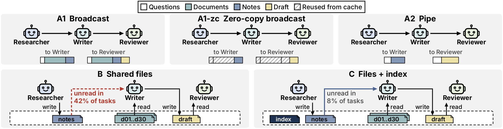
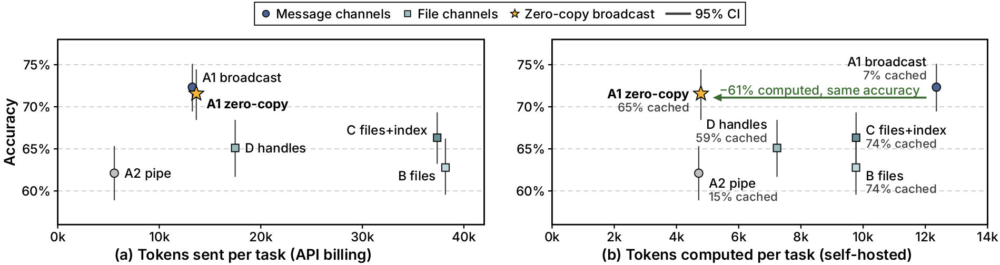
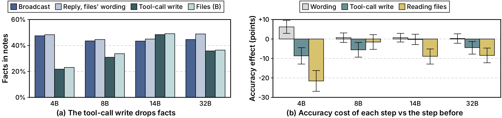
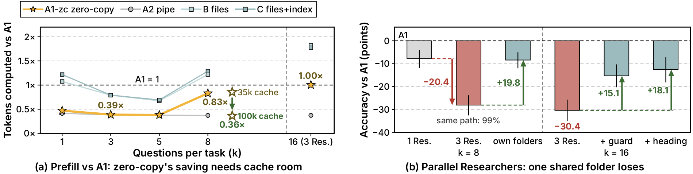

# Messages or Files? Revisiting IPC for LLM Agent Pipelines

LLM agents pass results to each other in two ways: by copying earlier output into the next agent's prompt, or by
leaving it in shared files that later agents read through tools. Operating systems face the same choice between
message passing and shared memory. This repository asks which channel works better for agents, by what cost, and why.
A **Researcher** reads the task's documents and writes notes, a **Writer** drafts answers, and a **Reviewer**
produces the final answers. They solve multi-hop QA tasks (HotpotQA and 2WikiMultihopQA, k questions per task)
with the same Qwen3 model (4B, 8B, 14B, or 32B) served by vLLM v0.33.0 with prefix caching. Only the channel
changes, and every channel runs the same tasks, so comparisons are paired by task.

The paper is [`paper/main.pdf`](paper/main.pdf). Every number in it is computed from `results/` by a script.

## Channels



| Code | Channel | How later agents get earlier results |
| --- | --- | --- |
| A1 | Broadcast | Every prompt copies all earlier messages (task and documents, notes, draft); the role instruction comes first. |
| A1-zc | Zero-copy broadcast | The same messages, with the shared history first and the role instruction last, so the prefix cache reuses the history's KV. |
| A2 | Pipe | Each agent gets only the previous agent's output. |
| B | Shared files | Documents, notes, and draft are files in a workspace; agents use `list_files`, `read_file`, and `write_file`, and each tool call is one model call. |
| C | Files with an index | B plus an `index.md` the workspace keeps current, and a rule to start each notes file with the questions it covers. |

A handoff channel (D) and several arms that change one factor at a time (`A1r`, `A1w`, `Bs`, `Bt`, ...) are
defined in [docs/data.md](docs/data.md#channel-and-arm-codes).

## Key findings

Unless noted: Qwen3-8B, three questions per task, both datasets pooled (the main run). In parentheses: 95% bootstrap
intervals that resample tasks.

- **The costs rank the channels differently (Fig. 2a-b, Sec. 4.1).** Files send the most tokens (B and C:
  2.9x and 2.8x broadcast's, from 17.0 and 15.9 model calls per task against 3.0), but the prefix cache absorbs
  the resending, so they compute 0.79x broadcast's prefill. Zero-copy broadcast cuts broadcast's prefill by 61%
  (38-49% of broadcast's per setting up to five questions) while its accuracy differs by -0.8 points (-2.9 to 1.4).
- **Zero-copy does not shorten runs at six concurrent tasks (Fig. 2c, Sec. 4.1).** Its runs take 1.08-1.10x
  broadcast's time, because decoding is 96% of broadcast's prefill-plus-decode time and zero-copy generates 1.2x
  the output tokens. With 32 concurrent tasks its median task took 0.81x and 0.83x broadcast's in two runs, but the
  batch 1.00x (cross-run comparisons).

  
- **Broadcast is the most accurate channel at three questions (Sec. 4.2).** It answers 72.3% of questions; B trails it significantly
  in all six settings (dataset x k = 1, 3, 5) by 5.6-13.6 points, the pipe in five, and C in two. Given only the
  draft, the pipe's Reviewer turns right answers wrong in up to 16% of questions per setting.
- **Where files lose depends on model size (Fig. 3a, Table 1, Sec. 4.3).** In the crossed runs, later agents
  that read tool-written notes as files lose 22.0, 8.9, and 8.2 points against copying them at 4B, 14B, and 32B
  (Holm-corrected; at 4B every file task needed the harness's rescue). At 8B, by point estimate, writing the
  notes through a tool call costs more (4.7 points on copied notes) than reading them as files (2.9), but neither cost nor their
  difference is Holm-significant. In the main run, B's Writer never opens the notes in 42% of tasks (C's: 8%).
  Naming the notes' path in later agents' prompts raised 32B accuracy by 14.2 points but 14B's by only 0.9
  (Fig. 3b; exploratory).

  
- **Larger tasks expose two limits (Fig. 4, Sec. 5.1-5.2).** Zero-copy's saving needs cache room: at eight
  questions it computes 0.83x broadcast's prefill (0.39x at three) once concurrent tasks outgrow the RTX 3090's
  34,864-token cache; on an RTX PRO 6000 the same tasks give 0.85x with that cache size and 0.36x with a 100k- or
  400k-token cache (cross-run). At eight questions, going from one to three parallel Researchers that share one
  folder lowers B's accuracy by 20.4 points more than broadcast's (-26.0 to -14.6; in 99% of tasks two
  Researchers wrote the same path), and a folder per Researcher recovers 19.8 points (15.6 to 23.6).

  
- **Model size changes which channels lose (Sec. 5.3).** The pipe stays within 1.2 points of broadcast with
  14B or 32B at three questions or 8B at sixteen (point estimates), at 0.41-0.42x its tokens, but with 8B at up
  to five questions it loses up to 14.9 points. In the size runs, zero-copy's prompt layout
  significantly lowers accuracy only with Qwen3-4B, by 7.0 points (3.0 to 11.2).

**What this suggests, and its limits.** For pipelines and file harnesses like ours, the runs suggest putting the
shared history first except with the smallest model, giving concurrent writers separate folders, naming the
notes' path for later agents (which helped at 32B but not at 14B), and copying rather than sharing files. The
last rule rests on a minimal harness (a 12-call tool budget, 2,048- or 4,096-token caps, and a forced-write rescue
in 72% of B's main-run tasks); single changes to it recovered 14-20 points in specific settings, so a better file
harness may close the gap. The study covers one model family, linear pipelines, multi-hop QA whose state fits in
the context, and no state larger than the context (such as codebases), where files may be the only option.

## Paper

[`paper/main.pdf`](paper/main.pdf) is built from `paper/main.tex`. Its numbers are LaTeX macros in
`paper/numbers.tex` and its appendix tables are in `paper/appendix_tables.tex`; both are generated, never typed.

```bash
.venv/bin/python -m agentipc.paper_numbers   # results/ -> paper/numbers.tex, appendix_tables.tex, appendix/*.txt
.venv/bin/python -m agentipc.figdata         # results/ -> paper/figs/data/*.json, *.csv (the plotted values)
cd paper && latexmk -pdf main.tex            # or: make -C paper (regenerates numbers.tex first)
```

The figure scripts `paper/figs/fig_*.py` draw with `archfig`, a plotting toolkit not distributed with this
repository (`make -C paper figures` runs `archfig run` on each). The rendered figures are committed in
`paper/figs/out/` (SVG, PDF, PNG) and the values they plot in `paper/figs/data/`.

## Data and analysis

Every run's per-task data is committed next to its summary in `results/<exp>/<run_id>/`: `rows.jsonl.gz` (one
row per task and channel: accuracy, tokens, prefill, file I/O, fact coverage) and `records.jsonl.gz` (every model
call, file operation, and stage text). No server is needed to analyze them.

```bash
git clone <this repository> cs632 && cd cs632
python3 -m venv .venv && .venv/bin/pip install -e ".[dev]"
.venv/bin/python analysis/example.py   # recomputes headline numbers and checks them against paper/numbers.tex
.venv/bin/python -c "from agentipc.load import load_rows; print(load_rows('t07_main').groupby(['k','channel']).acc.mean().unstack())"
```

- [`src/agentipc/load.py`](src/agentipc/load.py): `experiments()`, `load_rows(exp)` (a pandas DataFrame),
  `load_records(exp)`, reading only the committed files.
- [`docs/data.md`](docs/data.md): every column, its units and definition, and the channel and arm codes.
- [`analysis/example.py`](analysis/example.py): accuracy per channel, zero-copy's prefill cut, zero-copy minus
  broadcast with its bootstrap interval, and B's gap per setting, each checked against the paper's macro.

`agentipc.figdata` regenerates all figure data from the committed files alone. `agentipc.paper_numbers` reads
`results_raw/` when it exists and the committed copies otherwise; with the two datasets in `data/raw/`
(see Reproduce), it regenerates 1,676 of the 1,707 macros identically. The rest need the vLLM server logs, the
agents' workspace archives of two 32B runs, and AlignScore's scores of the synthetic validation pairs, which are
not distributed.

## Experiments

Each experiment ID has one config in `configs/<id>.yaml` and one run in `results/<id>/<run_id>/`.
[docs/experiments.md](docs/experiments.md) gives every ID's purpose, model, GPU and KV cache, k, tasks, arms, and
where the paper uses it. The paper's claims map to runs as follows (the functions of
`src/agentipc/paper_numbers.py` and `figdata.py` read exactly these runs).

| Paper | Claim | Experiments |
| --- | --- | --- |
| Fig. 1, Fig. 2a-b, Sec. 4.1-4.2 | Channels' cost and accuracy, Writer skips the notes | `t07_main` |
| Fig. 2c, Sec. 4.1 | Zero-copy's run time | `p06_alone_*`, `p11_alone_*_r2`, `p11_alone_*_r3` (6 at a time), `p11_c32_*` (32 at a time) |
| Sec. 3 (Noise) | Decoding noise and drift | `t09_repeat`, `p10_write_*`, `p02_size_8b` vs `t07_main` |
| Sec. 4.2 | Documents control, replay control, excluded variants | `t09_scope`, `t09_replay`, `t07_main` (D), `p14_read_*` (Br) |
| Fig. 3a, Table 1, Sec. 4.3 | Read and write costs per size, rescues | `p16_store_*` (crossed), `p10_write_*` (wording), `p14_read_*` (reply-output), `t07_main` |
| Fig. 3b, Sec. 4.3 | Naming the notes' path (exploratory) | `p17_told_14b`, `p17_told_32b`, `p18_first_14b` |
| Fig. 4a, Sec. 5.1 | Prefill as tasks grow and the cache fills | `t07_main`, `t08_k8`, `t08_large`, `p01_cache_35k`, `p01_cache_100k`, `p01_cache_400k` |
| Fig. 4b, Sec. 5.2 | Parallel Researchers, folders, write guard, heading rule, tool budget | `p15_k8_one`, `p15_k8_three`, `p12_k16_clobber`, `p07_k16_kv100k`, `p07_k16_b24` |
| Sec. 5.3 | Model size | `p02_size_*`, `p08_norm_32b`, `p09_zcreplay_4b`, `p09_zcreplay_8b` |
| App. E | Fact measures (AlignScore, LLM judges) | `t07_main` (`alignscore_validation.json`, `judge_*.json`) |
| App. H | Cut results | `t08_batch`, `t08_chain4`, `t08_fanout`, `t08_qwen4b`, `p03_corner_32b_35k` |

**Hardware.** `t*` runs: Qwen3-8B (one run Qwen3-4B) on up to three RTX 3090s (24 GB), one server per GPU, with
the KV cache vLLM sized from free memory: 34,864 tokens for 8B and 89,504 for 4B. `p*` runs: one RTX PRO 6000
Blackwell Server Edition (96 GB) per run, with the KV cache fixed by `--num-gpu-blocks-override` at 34,864,
100,000 (the default for these runs), or 400,000 tokens, so cache size is the same across model sizes. Each server
runs 6 pipelines at a time (32 in the `p11_c32_*` timing runs), and each pipeline has its own `cache_salt`, so no KV is reused
across tasks or channels. Setup notes for the second server: [docs/pro6000/README.md](docs/pro6000/README.md).

## Reproduce

**Environment.** Python 3.10+, and vLLM 0.33.0 for serving (in the same or a separate environment).

```bash
uv venv .venv && uv pip install -p .venv -e ".[dev]"      # or: python3 -m venv .venv && .venv/bin/pip install -e ".[dev]"
uv pip install -p .venv pyarrow                            # reads the HotpotQA parquet (runs, paper_numbers)
uv pip install -p .venv "vllm==0.33.0"                     # only needed to serve models
.venv/bin/python -m pytest -q
```

`scripts/serve.sh` reads a local `env.local.sh` (not committed) in the repository root:

```bash
export STORE=/path/with/space          # large files
export HF_HOME=$STORE/hf
export VLLM_BIN=$PWD/.venv/bin/vllm    # the vllm executable
export MODEL=Qwen/Qwen3-8B             # default model to serve
```

**Data** (about 85 MB) and models. The server runs with `HF_HUB_OFFLINE=1`, so download the models first.

```bash
mkdir -p data/raw
curl -sL -o data/raw/hotpot_distractor_validation.parquet \
  https://huggingface.co/datasets/hotpotqa/hotpot_qa/resolve/main/distractor/validation-00000-of-00001.parquet
curl -sL -o data/raw/2wiki_dev.json \
  https://huggingface.co/datasets/voidful/2WikiMultihopQA/resolve/main/dev.json
source env.local.sh && hf download Qwen/Qwen3-8B
```

**Serve and run one experiment.** Configs name their servers (`server.base_urls`); `--urls` overrides them.

```bash
scripts/serve.sh 0 8100                       # GPU 0, port 8100; pid in logs/vllm_gpu0.pid
.venv/bin/python -m agentipc.run configs/t07_main.yaml --urls http://localhost:8100 --gpus 0 --n-tasks 2   # drop --n-tasks for the full run
.venv/bin/python -m agentipc.report results/t07_main/<run_id>
scripts/stop_servers.sh
```

For another model or a fixed cache, set `SERVE_MODEL`, `SERVED_NAME` (the config's `server.served_name`, e.g.
`qwen3-14b`), `KV_BLOCKS` (16-token blocks: 2179, 6250, or 25000), and `GPU_UTIL` (0.92; 0.95 for 32B) before
`scripts/serve.sh`. A run writes `results/<exp>/<run_id>/` (config, environment, summary) and the per-task files
to `results_raw/<exp>/<run_id>/`; copy `rows.jsonl.gz` and `records.jsonl.gz` next to the summary to commit them.

**Score facts.** Fact coverage uses AlignScore-large in its own environment (setup in
[docs/pro6000/README.md](docs/pro6000/README.md#fact-scoring-with-alignscore)):

```bash
.venv/bin/python -m agentipc.factpairs --export results/<exp>/<run_id> pairs.jsonl
<alignscore-env>/bin/python scripts/alignscore_score.py pairs.jsonl scored.jsonl <gpu>
.venv/bin/python -m agentipc.alignfacts results/<exp>/<run_id> scored.jsonl
```

**Regenerate the paper**: `python -m agentipc.paper_numbers`, `python -m agentipc.figdata`, then `latexmk` (see
[Paper](#paper)).

## Repository layout

```
README.md, pyproject.toml   overview; the agentipc package and its dependencies
PROGRESS.md                 task log of the project, with dates and results
configs/                    one YAML file per experiment ID
src/agentipc/               the harness (data, pipeline, workspace, llm, metrics, run), analysis (analyze, stats,
                            load), fact scoring (factpairs, alignfacts, judge_*), paper generators (paper_numbers,
                            appendix_tables, figdata)
analysis/                   example analysis that recomputes paper numbers from the committed rows
results/<exp>/<run_id>/     per run: config, environment, summaries, per-task rows and records (docs/data.md)
results/_failed/            smoke runs and one stopped run, each with a notes.txt
results/pro6000*_kv_used.txt  KV size and memory utilization of every RTX PRO 6000 run, from its server log
scripts/                    vLLM server and experiment queue scripts (scripts/README.md)
docs/                       data dictionary, experiment list, RTX PRO 6000 setup
paper/                      main.tex, main.pdf, refs.bib, Makefile; generated numbers.tex and appendix_tables.tex
paper/appendix/             verbatim listings for the appendix (generated)
paper/figs/                 figure scripts; data/ holds the plotted values, out/ the rendered figures
paper/reviews/              review rounds and revision logs from writing the paper
paper/related_work.md       annotated related-work notes
tests/                      unit and smoke tests (pytest)
```

Not in git: `data/` (the datasets), `logs/` (server and queue logs), `results_raw/` (the run outputs as written,
including the agents' workspace archives), and `.venv`.
